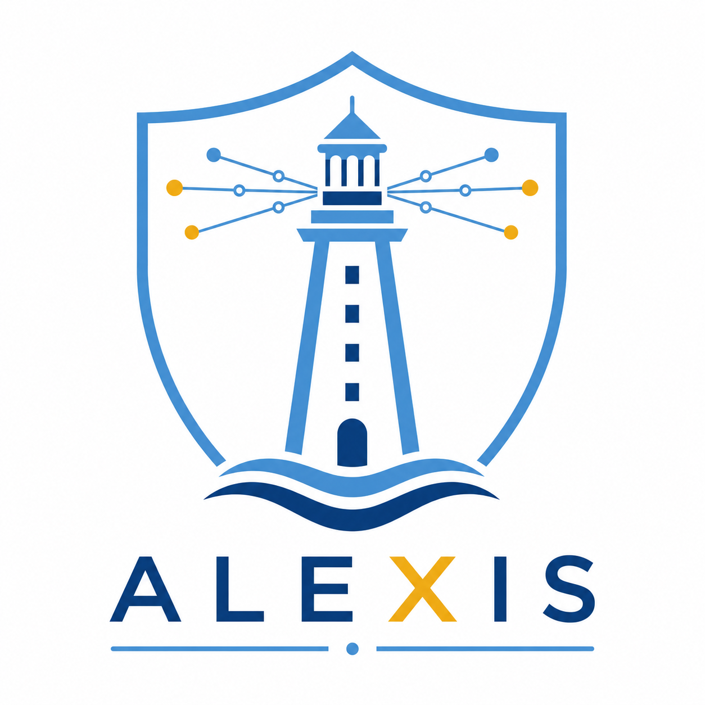
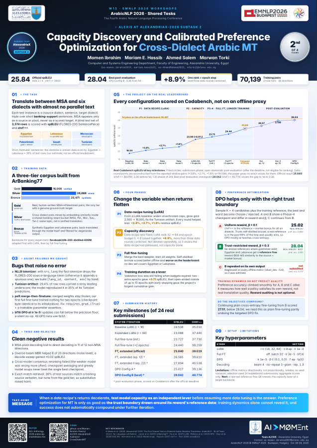

<p align="center">
  
  &nbsp;&nbsp;&nbsp;&nbsp;
  
</p>

# ALEXIS — Subtask 2: Cross-Dialect Arabic MT (AlexandriaX-2026)

Code to reproduce team ALEXIS's submissions for AlexandriaX-2026 Subtask 2 (Cross-Dialect
Arabic MT): translating short banking-support sentences between Modern Standard Arabic and six
regional dialects, fine-tuning `facebook/nllb-200-distilled-600M`.

## Layout

```
src/           core library + main pipeline entrypoints (see table below)
experiments/   ablation/diagnostic scripts (7 files) -- these correspond directly
               to Appendix C ("Techniques Tried and Rejected") in the paper
assets/        logos used in this README
```

## Files (all under `src/`)

| File | Purpose |
|---|---|
| `data_prep.py`, `build_finetune_corpus.py` | Build the training corpus from raw ArBanking77 data |
| `mine_silver_pairs.py` | Embedding-similarity cross-dialect pair mining |
| `synthetic_backtranslation.py`, `clean_bronze.py` | Synthetic pair generation and filtering |
| `lang_codes.py`, `nllb_utils.py` | Dialect/language-code mapping and shared tokenization helpers |
| `train_nllb_lora.py` | LoRA fine-tuning |
| `train_full_ft.py` | Full-parameter fine-tuning (`--continue-from-model`, `--early-stopping-patience`) |
| `dpo_finetune.py` | Direct Preference Optimization (pure PyTorch, no `trl`) |
| `generate_predictions.py`, `make_submission.py` | Produce and package a Codabench submission |
| `evaluate.py` | Offline dev-set evaluation |
| `spbleu_chrf.py` | spBLEU / chrF++ scoring via `sacrebleu` |
| `audit_dialect_markers.py` | Dialect-authenticity sanity check on a prediction file |

`experiments/` holds `average_checkpoints.py`, `model_soup.py` (checkpoint-averaging
utilities), `auto_submit_pipeline.py` (watches a training run and auto-packages each new
checkpoint), and `decode_sweep.py`, `mbr_eval.py`, `cross_model_mbr_eval.py`, `pivot_eval.py`
(decoding/reranking ablations) -- each imports the `src/` modules above directly (e.g.
`from nllb_utils import build_ids`) via a small `sys.path` shim at the top of the file, so run
them from anywhere. `SUBMISSIONS_LOG.md` (repo root) maps tag → real leaderboard score for
every scored submission.

Model checkpoints, the raw shared-task data, and run outputs are not included (see
`.gitignore`) — the shared task's own data distribution is required to reproduce the corpus.

## How to run

```bash
pip install -r requirements.txt

# 1. Build the three-tier corpus (expects the shared task's raw data under Data/,
#    see src/data_prep.py for the exact expected layout)
python src/data_prep.py
python src/mine_silver_pairs.py
python src/synthetic_backtranslation.py && python src/clean_bronze.py
python src/build_finetune_corpus.py

# 2. LoRA fine-tune, then full fine-tune from the merged adapter
python src/train_nllb_lora.py --out-name lora_v4b --lora-r 64 --epochs 8
python src/train_full_ft.py --init-adapter outputs/checkpoints/lora_v4b/adapter --out-name fullft_v4binit --epochs 3

# 3. Continue training past its original budget with early stopping
python src/train_full_ft.py --continue-from-model outputs/checkpoints/fullft_v4binit/model \
  --out-name fullft_continued --epochs 10 --early-stopping-patience 2

# 4. Preference-optimize the best full fine-tuning checkpoint
python src/dpo_finetune.py --base-model outputs/checkpoints/fullft_continued/model --out-name dpo_v2 --epochs 7

# 5. Generate predictions and package a submission
python src/generate_predictions.py --model outputs/checkpoints/dpo_v2 --out-name predictions.csv
python src/make_submission.py outputs/predictions/predictions.csv --tag dpo_v2
```

`src/evaluate.py --model <checkpoint_dir> --tag <name>` scores any checkpoint against the
offline dev sets; `src/audit_dialect_markers.py <predictions.csv>` is a quick sanity check
before submitting.

## 🎤 ArabicNLP 2026 Poster & Presentation

Poster and slides for **The Fourth Arabic Natural Language Processing Conference (ArabicNLP 2026)**,
co-located with **EMNLP 2026**, Budapest, Hungary (October 28–29, 2026).

<p align="center">
  <a href="presentation/ALEXIS_Poster_AlexandriaX_Subtask2_CrossDialectMT.pdf"></a>
</p>

| | |
|---|---|
| 📄 Paper | [ACL Anthology](https://aclanthology.org/2026.arabicnlp-sharedtasks.104/) · [PDF](https://aclanthology.org/2026.arabicnlp-sharedtasks.104.pdf) |
| 🖼️ Poster | [PDF](presentation/ALEXIS_Poster_AlexandriaX_Subtask2_CrossDialectMT.pdf) |
| 📊 Slides | [PDF](presentation/ALEXIS_AlexandriaX_Subtask2_CrossDialectMT_Presentation.pdf) · [PowerPoint](presentation/ALEXIS_AlexandriaX_Subtask2_CrossDialectMT_Presentation.pptx) |
| 🎬 Poster video | [MP4 download](https://github.com/Momen-Ibrahim-Fawzy/ALEXIS-AlexandriaX-Subtask2-CrossDialectMT/releases/download/arabicnlp2026/ALEXIS_Poster_AlexandriaX_Subtask2_CrossDialectMT_final.mp4) (from the [release](https://github.com/Momen-Ibrahim-Fawzy/ALEXIS-AlexandriaX-Subtask2-CrossDialectMT/releases/tag/arabicnlp2026)) |

---

## Citation

Paper: [https://aclanthology.org/2026.arabicnlp-sharedtasks.104/](https://aclanthology.org/2026.arabicnlp-sharedtasks.104/)

If you use this code, please cite our paper:

```bibtex
@inproceedings{ibrahim-etal-2026-alexis,
    title = "{ALEXIS} at {A}lexandria{X}-2026 Subtask 2: Capacity Discovery and Calibrated Preference Optimization for Cross-Dialect {A}rabic {MT}",
    author = "Ibrahim, Momen  and
      Hassib, Mariam E.  and
      Mahmoud Salem, Ahmed  and
      Torki, Marwan",
    editor = "Abdul-Mageed, Muhammad  and
      Elsayed, Tamer  and
      Bouamor, Houda  and
      El-Beltagy, Samhaa  and
      Al-Khalifa, Hend  and
      Abdelali, Ahmed  and
      Elmadany, AbdelRahim  and
      El Mekki, Abdellah  and
      Darwish, Kareem  and
      Alkhereyf, Sakhar  and
      Luqman, Hamzah  and
      Khalifa, Salam  and
      Magdy, Samar  and
      Alyafeai, Zaid  and
      Hamed, Injy  and
      Zaghouani, Wajdi  and
      Zitouni, Imed",
    booktitle = "Proceedings of The Fourth {A}rabic Natural Language Processing Conference: Shared Tasks",
    month = oct,
    year = "2026",
    address = "Budapest, Hungary",
    publisher = "Association for Computational Linguistics",
    url = "https://aclanthology.org/2026.arabicnlp-sharedtasks.104/",
    pages = "834--841",
    ISBN = "979-8-89176-497-2"
}
```

Please also cite the AlexandriaX-2026 shared task overview paper:

```bibtex
@inproceedings{elmekki-etal-2026-alexandriax,
  title = "{AlexandriaX-2026: The First Context-Aware Dialectal Arabic MT and MT Evaluation Shared Task}",
  author = "El Mekki, Abdellah and Elmadany, AbdelRahim A. and Magdy, Samar M. and Ezzini, Saad and El-Haj, Mo and Jarrar, Mustafa and El-Beltagy, Samhaa and Abbas, Mourad and Zaraket, Fadi and Al Mandhari, Salim and Alyafeai, Zaid and Ghanem, Bernard and Abdul-Mageed, Muhammad",
  booktitle = {Proceedings of the Fourth Arabic Natural Language Processing Conference (ArabicNLP 2026)},
  year = "2026",
  address = "Budapest, Hungary",
  publisher = "Association for Computational Linguistics",
}
```
